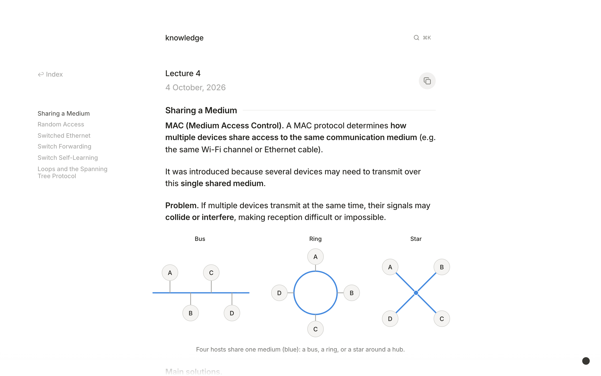

# knowledge

Course notes in MDX (`notes/`) and the Next.js site that renders them (`site/`).
A Cloudflare Worker serves the static export, answers search, and gates the
private CTF course.

[knowledge.elazdi.com](https://knowledge.elazdi.com)



Stack: Next.js 16, React 19, Tailwind 4, MDX with KaTeX and Shiki, Base UI and
cmdk, Cloudflare Workers, Bun.

## Run

```sh
cd site
bun install
bun run dev                 # http://localhost:3000, rereads ../notes on every request
bun run build               # static export to out/, with the search index
bun run preview             # build, then serve out/ and the Worker with wrangler dev
bun run deploy              # build, then wrangler deploy
bun run typecheck
bun run verify <note.mdx>   # render one note; fails on MDX errors and unknown components
bun run check:figures       # fails on a registered figure that no note uses
bun run check:math          # fails if a math delimiter stops converting or rendering
```

Set the CTF password with `wrangler secret put CTF_PASSWORD`, or in `.dev.vars`
locally. `wrangler.toml` pins the Cloudflare account, so unset any
`CLOUDFLARE_API_TOKEN` for another account before you deploy.

## Notes

`notes/<course>/<slug>.mdx` is served at `/notes/<course>/<slug>`. `RULES.md` says
how to write a note. The frontmatter schema is in `site/src/lib/notes.ts`.

```md
---
title: "Data Intensive Systems: Lecture 9"   # required
created: 2026-06-21                          # shown under the title
draft: true                                  # left out of the build
---
```

Write inline math as `$...$` or `\(...\)`, and display math as `$$...$$` or
`\[...\]`.

Each course is a homepage tab, named by the shared title prefix. Three cases differ:

- `archived: true` on a course in `site/src/lib/courses.ts` moves it into the
  `archive` tab.
- `notes/writing/` holds standalone posts, listed newest first.
- `notes/ctf/<category>/` holds the private notes, grouped by category. Git ignores
  this folder.

## Figures

`site/src/mdx-components.tsx` registers every component, so notes import nothing.
Figures compose the primitives in `site/src/components/figure/`. Colors are the
`--dg-*` tokens in `site/src/app/diagram-tokens.css`.

From `site/`, `bun scripts/shoot-figures.tsx [course/slug ...]` screenshots figures
to `/tmp/figures`. It needs `bun run dev` and Playwright's Chromium.

## License

Code is MIT (`LICENSE`). Notes are CC BY 4.0 (`notes/LICENSE`).
